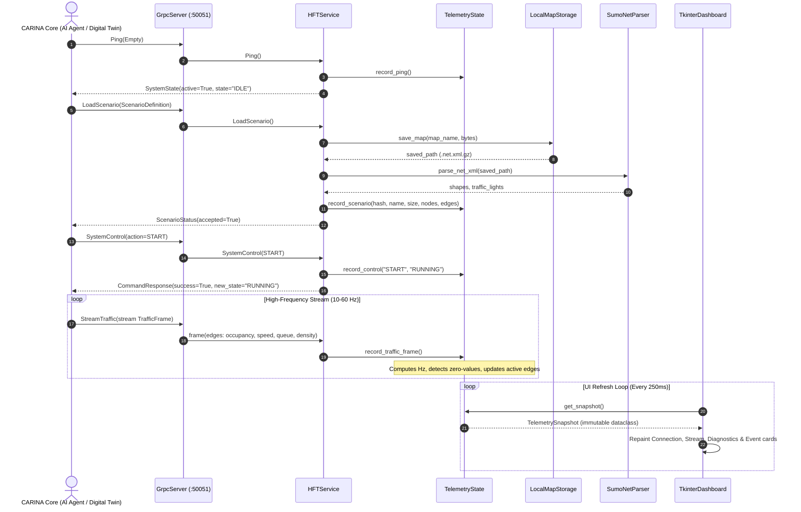

<!--
SPDX-FileCopyrightText: 2026 Noxfort Systems <gabriel.moraes@noxfortsystems.com>
SPDX-License-Identifier: Apache-2.0
-->

# 🏛️ CARINA MOCK SERVER: System Architecture Blueprint

This document specifies the internal engineering architecture of **CARINA MOCK SERVER** — the High-Frequency Telemetry (HFT) and Synapse Protocol Test Harness for the Noxfort Systems autonomous mobility ecosystem.

⬅️ [Documentation Hub](docs/README.md) | ⚡ [Synapse Protocol API](docs/API_REFERENCE.md) | 🖥️ [Tkinter UI](docs/UI_AND_DASHBOARD.md) | 🧪 [Testing & Validation](docs/TESTING.md)

---

## 1. Architectural Principles & Layered Design

CARINA MOCK SERVER is designed following **Clean Architecture** and strict **SOLID** principles:

1. **Single Responsibility Principle (SRP):** Each class encapsulates a single concern (e.g., `SumoNetParser` only parses network XML, `LocalMapStorage` only handles disk I/O, `TelemetryState` only maintains thread-safe telemetry).
2. **Open/Closed Principle (OCP):** New loggers, storage engines, or UI renderers can be added by implementing interfaces from `src/core/interfaces.py` without modifying existing core logic.
3. **Liskov Substitution Principle (LSP):** All logger implementations (`ConsoleLogger`, `FileLogger`, `CompositeLogger`) implement `ILogger` transparently.
4. **Interface Segregation Principle (ISP):** Clients depend only on specific interfaces: `ITelemetryCollector` (for write operations from gRPC) and `ITelemetryProvider` (for read-only queries from the UI).
5. **Dependency Inversion Principle (DIP):** High-level services (`HFTService`, `ReceiverFacade`) depend on abstractions (`src/core/interfaces.py`), never on concrete infrastructure classes.

---

## 2. Component Architecture & System Layers

```mermaid
graph TD
    CLI[main.py / CLI Args] -->|Instantiates| Facade[ReceiverFacade]
    
    subgraph Core Layer ["Core Layer (Abstractions & State)"]
        Interfaces[src/core/interfaces.py]
        Config[src/core/config.py]
        State[src/core/telemetry_state.py<br/>ITelemetryCollector & ITelemetryProvider]
    end

    subgraph Application Layer ["Application Layer (Protocols)"]
        HFT[src/application/hft_service.py<br/>HFTLinkServicer]
    end

    subgraph Infrastructure Layer ["Infrastructure Layer (I/O & Hardware)"]
        GRPC[src/infrastructure/grpc_server.py]
        Storage[src/infrastructure/map_storage.py]
        Parser[src/infrastructure/sumo_parser.py]
        Loggers[src/infrastructure/composite_logger.py<br/>ConsoleLogger & FileLogger]
    end

    subgraph Presentation Layer ["Presentation Layer (UI)"]
        UI[ui/dashboard.py<br/>TkinterDashboard]
        Cards[ui/components/*<br/>Header, Stream, Diagnostics, Events]
    end

    Facade --> Core Layer
    Facade --> Application Layer
    Facade --> Infrastructure Layer
    Facade --> Presentation Layer

    GRPC -->|Dispatches RPCs| HFT
    HFT -->|Records Metrics| State
    HFT -->|Persists Map| Storage
    HFT -->|Extracts Topology| Parser
    UI -->|Reads Snapshot| State
```

---

## 3. High-Frequency Telemetry (HFT) Sequence Flow

The following sequence illustrates the life cycle of scenario loading and high-frequency traffic streaming between the CARINA Core AI / Synapse client and the Mock Server:



---

## 4. Concurrency & Thread-Safety Model

1. **gRPC Worker Pool:** `GrpcServer` utilizes a `futures.ThreadPoolExecutor(max_workers=10)` to service concurrent client requests without blocking.
2. **Synchronized Telemetry State:** `TelemetryState` guards all mutable state (connection status, frame counts, circular buffers, zero-value diagnostics) behind a dedicated `threading.Lock()`.
3. **Decoupled UI Snapshots:** The UI reads state exclusively via `get_snapshot()`, which constructs an immutable `TelemetrySnapshot` within a critical section. The UI thread never holds locks while rendering.
4. **Graceful Shutdown & Signal Handlers:** OS signals (`SIGINT`, `SIGTERM`) are intercepted by `ReceiverFacade`, triggering ordered shutdown of the gRPC server, file loggers, and GUI windows.

---

## 5. Zero-Value Data Detection Engine

In distributed reinforcement learning for urban mobility, a common failure mode is the ingestion of empty frames (where network sockets transmit frames containing all zeros for occupancy, velocity, and queue length).

`TelemetryState` incorporates an active diagnostic algorithm:
- Every edge in a `TrafficFrame` is evaluated against an epsilon threshold ($\epsilon = 10^{-4}$).
- If $\text{active\_count} = 0$, `all_zeros` is set to `True`, triggering a visual warning banner in the Tkinter UI and a structured warning log.
- Telemetry captures up to 5 representative active edge samples and up to 3 zero-state edge samples for real-time visual inspection in the `DiagnosticsCard`.

---

<div align="center">
  <br/>
  <b>Noxfort Systems</b> — <i>A State Of Art Company</i><br/>
  <i>Technical Architecture Blueprint • CARINA MOCK SERVER</i>
</div>
