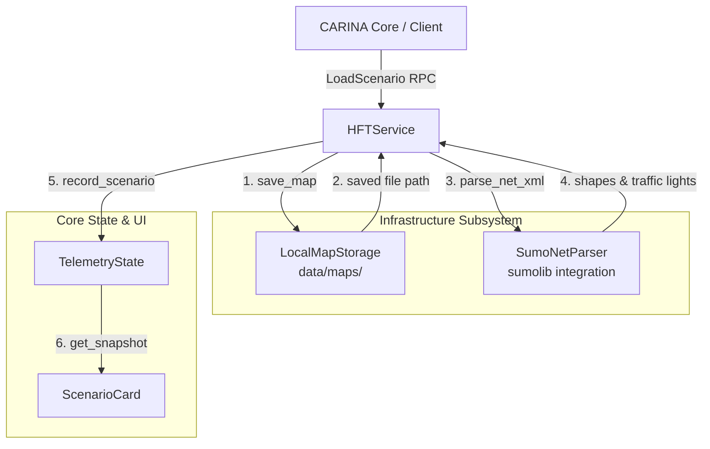

<!--
SPDX-FileCopyrightText: 2026 Noxfort Systems <gabriel.moraes@noxfortsystems.com>
SPDX-License-Identifier: Apache-2.0
-->

# 🗺️ SUMO Road Network Storage & Topology Parser Guide

This document specifies the map ingestion, binary storage, and SUMO network topology parsing subsystem of the **CARINA MOCK SERVER**.

⬅️ [Documentation Hub](README.md) | 🏛️ [Architecture](ARCHITECTURE.md) | ⚡ [API Reference](API_REFERENCE.md) | 🖥️ [Tkinter UI](UI_AND_DASHBOARD.md)

---

## 1. Overview & Subsystem Role

In the CARINA urban traffic control ecosystem, road networks are represented using the Eclipse SUMO (Simulation of Urban MObility) microscopic simulation format. During test execution, client applications send full road networks and spatial topologies to the Mock Server via the `LoadScenario` gRPC call.

The Mock Server handles this lifecycle through two decoupled infrastructure components:
1. **`LocalMapStorage` (`src/infrastructure/map_storage.py`):** Manages safe filesystem persistence and file extension normalization for incoming raw binary map streams.
2. **`SumoNetParser` (`src/infrastructure/sumo_parser.py`):** Parses XML road networks using `sumolib`, extracting lane geometries and identifying nodes controlled by Traffic Light Systems (TLS).



---

## 2. Binary Map Storage (`src/infrastructure/map_storage.py`)

The `LocalMapStorage` class implements the `IMapStorage` interface declared in `src/core/interfaces.py`.

### 2.1 Storage Specifications
- **Destination Directory:** Default is `data/maps/` (automatically created if not present).
- **Extension Normalization:** If a filename lacks an extension, `LocalMapStorage` automatically appends `.net.xml`. Gzip-compressed files (`.gz`) are preserved as `.net.xml.gz`.
- **Atomic File Writing:** Binary byte arrays (`bytes map_file_content`) are written directly to disk using standard buffered binary I/O.
- **Path Resolution:** Provides `get_map_path(map_name)` to locate existing maps on disk for re-use across test runs.

```python
from src.infrastructure.map_storage import LocalMapStorage

storage = LocalMapStorage(storage_dir="data/maps")
saved_path = storage.save_map("londrina_central.net.xml", binary_data)
# saved_path -> "/abs/path/to/data/maps/londrina_central.net.xml"
```

---

## 3. SUMO Network XML Parser (`src/infrastructure/sumo_parser.py`)

The `SumoNetParser` implements `IMapParser` to inspect the road network geometry.

### 3.1 Extracted Features
1. **Lane Polylines & Shapes:** Iterates through `net.getEdges()` and `edge.getLanes()`, reading `lane.getShape()`. Returns coordinate lists formatted for vector rendering:
   ```python
   {
       'id': f"{edge_id}_{lane.getID()}",
       'points': [(x1, y1), (x2, y2), ...]
   }
   ```
2. **Traffic Light Controlled Intersections:** Iterates through `net.getNodes()`, filtering for `node.getType() == "traffic_light"`. Extracts the node coordinate `(x, y)` and node identifier `node.getID()`.

### 3.2 Error Resilience & Graceful Fallback
- If `sumolib` is not installed in the Python runtime, `SumoNetParser` catches the `ImportError`, logs a structured warning, and returns empty lists without interrupting scenario ingestion or crashing the server.
- Non-existent or corrupt XML files return empty collections and log error details without terminating the gRPC service.

---

## 4. Protobuf Wire Message Format

The scenario is transmitted in the `ScenarioDefinition` message defined in `proto/synapse_hft.proto`:

```protobuf
message ScenarioDefinition {
  string map_hash = 1;              // SHA-256 integrity hash
  TopologyGraph graph = 2;          // Nodes and directed edges
  MapGeometry geometry = 3;         // Visual shape polygons
  bytes map_file_content = 4;       // Raw binary (.net.xml or .net.xml.gz)
  string map_file_name = 5;         // Target filename
  string peak_schedule_json = 6;    // Optional traffic peak timing plan
}
```

---

## 5. Visual Dashboard Presentation

Once parsed, scenario metadata is reflected in real-time in the desktop UI:
- **`ScenarioCard`:** Displays the active map name, SHA-256 hash, extracted node count, edge count, and file size in KB.
- **Event Log:** Emits a milestone message (e.g., `[14:22:01] Cenário carregado: londrina.net.xml (42 nós, 128 arestas, 340.5 KB)`).

---

<div align="center">
  <br/>
  <b>Noxfort Systems</b> — <i>A State Of Art Company</i><br/>
  <i>Road Network Storage & Parser Guide • CARINA MOCK SERVER</i>
</div>
