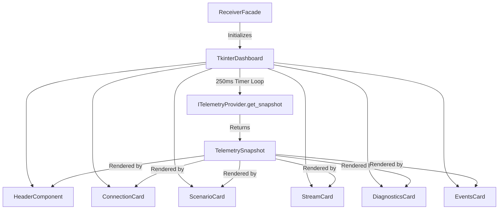

<!--
SPDX-FileCopyrightText: 2026 Noxfort Systems <gabriel.moraes@noxfortsystems.com>
SPDX-License-Identifier: Apache-2.0
-->

# 🖥️ Tkinter Dashboard & Real-Time Diagnostics Guide

This document describes the presentation architecture, user interface design, and real-time telemetry diagnostics engine of the **CARINA MOCK SERVER**.

⬅️ [Documentation Hub](README.md) | 🏛️ [Architecture](../ARCHITECTURE.md) | ⚡ [API Reference](API_REFERENCE.md) | 🧪 [Testing](TESTING.md)

---

## 1. Presentation Architecture & UI Design

The CARINA MOCK SERVER features a desktop graphical dashboard built with **Python Tkinter**, customized with a modern dark theme inspired by industrial operations centers.



### 1.1 Non-Blocking Polling Model
To prevent thread locking and GUI freezing, the dashboard follows a decoupled polling pattern:
1. The gRPC server and background threads write state directly to `TelemetryState`.
2. The UI runs on the main thread and schedules a non-blocking refresh tick every **250 ms** (`self.root.after(250, self._update_loop)`).
3. In each tick, the UI queries an immutable `TelemetrySnapshot` and updates the visual cards.

---

## 2. Noxfort Dark Visual Theme (`ui/theme.py`)

The visual identity uses a high-contrast dark palette designed for long operational monitoring sessions:

| Token | Hex Color | Usage |
|---|---|---|
| `BG_DARK` | `#1e1e2e` | Main window background |
| `BG_CARD` | `#181825` | Card component background |
| `BG_ACCENT` | `#313244` | Metric pill and table header background |
| `TEXT_PRIMARY` | `#cdd6f4` | High-emphasis titles and values |
| `TEXT_SECONDARY` | `#a6adc8` | Labels, subtitles, and metadata |
| `COLOR_SUCCESS` | `#a6e3a1` | Connected status, active traffic data |
| `COLOR_WARNING` | `#f9e2af` | Empty frames, zero-value data warning |
| `COLOR_ERROR` | `#f38ba8` | Disconnected state, errors |
| `COLOR_INFO` | `#89b4fa` | gRPC address, throughput in Hz |

---

## 3. Modular Card Components

### 3.1 Header Component (`ui/components/header.py`)
Displays the CARINA ecosystem brand and a real-time status pill indicating whether a client connection is active or idle.

### 3.2 Connection Card (`ui/components/connection_card.py`)
Presents gRPC network parameters:
- **Server Address:** e.g., `0.0.0.0:50051`.
- **System State:** `IDLE`, `READY`, `RUNNING`, or `PAUSED`.
- **Heartbeat Monitor:** Time elapsed since the last received Ping or frame.

### 3.3 Scenario Card (`ui/components/scenario_card.py`)
Details the currently active simulation scenario:
- **Network Map Name:** e.g., `londrina_central.net.xml`.
- **Map Hash:** SHA-256 identifier of the topology.
- **Topology Complexity:** Node and edge counts extracted from the network.
- **Payload Size:** File size in kilobytes.

### 3.4 Stream Card (`ui/components/stream_card.py`)
Monitors the high-frequency packet flow:
- **Total Frames Ingested:** Cumulative count of traffic packets.
- **Last Sequence ID:** Continuous frame counter from the client.
- **Streaming Frequency (Hz):** Measured packet rate over a 20-sample rolling window.

### 3.5 Diagnostics Card (`ui/components/diagnostics_card.py`)
Houses the **Zero-Value Data Detection Engine**:
- **Alert Banner:** 
  - 🟢 **ACTIVE DATA:** Non-zero occupancy and vehicle speeds detected across lanes.
  - ⚠️ **ALL ZERO DATA:** Warning alert indicating incoming frames have zero occupancy, zero speed, and zero queue across all edges.
- **Aggregate Metrics:** Total edges, active edges count, maximum occupancy %, and mean speed (m/s).
- **Edge Sample Table:** Live inspection table showing up to 5 individual lanes with occupancy, velocity, and queue length.

### 3.6 Events Card (`ui/components/events_card.py`)
Displays a rolling buffer of the 15 most recent server events (scenario uploads, client connections, milestone frame receipts).

---

## 4. Headless Execution Mode

For deployment in Docker containers, cloud VMs, and continuous integration pipelines without a graphical display server (X11/Wayland), CARINA MOCK SERVER supports seamless headless execution:

```bash
# Explicit CLI flag
python main.py --no-gui

# Environment variable configuration
MOCK_SERVER_NO_GUI=1 python main.py
```

If the server attempts to launch the GUI on an environment without a display, `ReceiverFacade` catches the display exception and automatically falls back to headless mode without terminating.

---

<div align="center">
  <br/>
  <b>Noxfort Systems</b> — <i>A State Of Art Company</i><br/>
  <i>Tkinter UI & Diagnostics Guide • CARINA MOCK SERVER</i>
</div>
