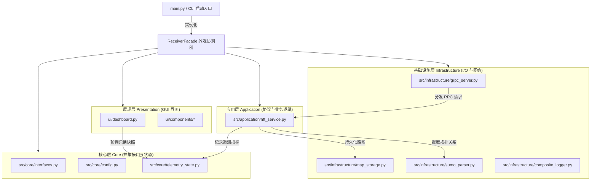

<!--
SPDX-FileCopyrightText: 2026 Noxfort Systems <gabriel.moraes@noxfortsystems.com>
SPDX-License-Identifier: Apache-2.0
-->

# 🏛️ CARINA MOCK SERVER: 系统架构蓝图与软件工程设计

本文档详细阐述 **CARINA MOCK SERVER** 的内部软件工程架构，涵盖整洁架构分层、SOLID 原则实现、并发模型与实时遥测诊断机制。

⬅️ [文档中心主页](../README.md) | ⚡ [API 参考](api_reference.md) | 🖥️ [Tkinter 仪表盘](ui_and_dashboard.md) | 🧪 [测试验证](testing.md)

---

## 1. 架构原则与分层设计

CARINA MOCK SERVER 全面贯彻 **整洁架构** 与 **SOLID 原则**：

1. **单一职责原则 (SRP)：** 各功能模块高内聚并独立演进：
   - `SumoNetParser`：仅负责解析 SUMO 仿真路网 XML 及提取信号控制节点。
   - `LocalMapStorage`：专注于路网二进制数据持久化与 gzip 解压。
   - `TelemetryState`：集中管理线程安全的指标计算与滑动窗口。
2. **开闭原则 (OCP)：** 新的日志驱动或存储后端可通过实现 `src/core/interfaces.py` 中的接口无缝扩展，无需修改核心控制流。
3. **里氏替换原则 (LSP)：** 所有日志实现 (`ConsoleLogger`, `FileLogger`, `CompositeLogger`) 均透明实现 `ILogger`。
4. **接口隔离原则 (ISP)：** 客户端仅依赖专用接口：
   - `ITelemetryCollector`：提供给 gRPC 处理器的写入方法。
   - `ITelemetryProvider`：提供给前端界面的只读快照查询。
5. **依赖倒置原则 (DIP)：** 高层应用逻辑 (`HFTService`, `ReceiverFacade`) 严格依赖抽象接口，彻底与底层基础设施解耦。

---

## 2. 系统组件与数据流架构

---

## 3. 并发模型与线程安全

- **gRPC 线程池：** `GrpcServer` 维护一个 `ThreadPoolExecutor(max_workers=10)`，异步分发遥测数据包，杜绝 I/O 阻塞。
- **互斥锁保护内部状态：** `TelemetryState` 使用内置 `threading.Lock()` 对所有可变状态（吞吐频率、数据帧计数、样本列表）进行临界区保护。
- **不可变快照隔离：** Tkinter 渲染线程每 250 毫秒通过 `get_snapshot()` 获取一份在临界区内生成的不可变 `TelemetrySnapshot`，实现前端无锁安全渲染。
- **系统信号拦截与优雅退出：** `ReceiverFacade` 捕获操作系统的 `SIGINT` 和 `SIGTERM` 信号，确保网络服务平稳下线与文件正常关闭。

---

## 4. 全零异常数据诊断引擎

在强化学习交通控制系统中，网络抖动或传感器采集失效常常导致发送连续全零的数据包（占有率=0、速度=0、排队=0），从而造成智能体决策退化。

测试平台对每个传入的数据帧进行动态评估：
- 逐一比对路网车道指标与微小阈值 $\epsilon = 10^{-4}$。
- 若所有车道均无有效数据，即刻标记 `all_zeros = True`，在前端仪表盘上亮起黄色警告指示，并在日志中记录预警信息。

---

   
  <b>Noxfort Systems</b> — <i>A State Of Art Company</i> 
  <i>系统架构规范 • CARINA MOCK SERVER</i>

